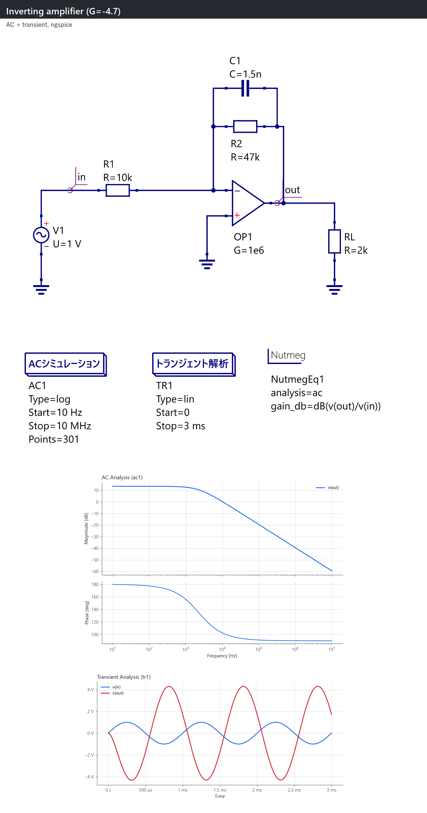

# qucs-s-mcp

AIエージェントから回路シミュレーター **Qucs-S**（計算エンジン: **ngspice**）を操作するための MCP サーバーです。
回路図(.sch)の作成・編集、自動配線、レイアウト検査と整頓、**スナップショット撮影**、ngspice シミュレーション、結果グラフ、報告用レポート画像の作成までを MCP ツールとして提供します。



## 特長

- **Qucs-S 本来の見た目でスナップショット** — `qucs-s --print` の SVG 出力を座標校正し、白背景・高解像度 PNG に描き直します。生成した PNG は MCP の画像コンテンツとして返るので、AI の Vision にそのまま渡せます。
  - 推論用のオーバーレイ: 10/50 単位グリッドと**座標ルーラー**、ネットの色分けと名前タグ、ピン位置、問題箇所の番号付きマーカー、ハイライト、領域/部品へのズーム
  - ユーザー報告用: `grid=false, rulers=false` のクリーン画像、回路図＋グラフをまとめた `create_report`
- **整頓のための道具一式**
  - `connect`: シンボルを避け、他ネットと重ならない直交配線を A* で自動生成（曲がり・交差を最小化）
  - `check_layout`: 未接続ピン、*見た目は繋がっているが Qucs では接続されない* T 字接合 / 配線途中のピン、部品の重なり、シンボルを貫く配線、文字と配線・部品の重なり、グリッド外れ、斜め配線などを検出し、配線長・曲がり数・交差数のメトリクスも返します
  - `tidy_schematic`: グリッド吸着、配線の結合・重複削除、部品ラベル/ネットラベルの空き位置への再配置、シミュレーションブロックの整列、全配線の引き直し
  - `move_components`: 部品を動かすと接続配線を自動で引き直します
- **部品データベース** — インストール済み Qucs-S から 220 種のコンポーネント（プロパティ名・既定値・説明、ピン座標、シンボル外形）を自動抽出。ピン座標はネットリスト生成による実測で、回転・ミラーも Qucs と一致することを確認済み。ライブラリ部品(`Lib`)とサブ回路(`Sub`)はピンを動的に計測します。
- **ngspice シミュレーション** — Qucs-S 自身にネットリストを生成させ (`qucs-s -n --ngspice`)、ngspice をバッチ実行。OP/DC スイープ/AC/過渡などの結果(ASCII/バイナリ raw)を解析し、要約・補間値・表・Bode 線図などで返します。

## 必要環境

- Windows / Linux（Windows 11 + Qucs-S 26.1.1 + ngspice 45.2 で確認）
- [Qucs-S](https://ra3xdh.github.io/) — `C:\Program Files\Qucs-S` か PATH 上。別の場所なら環境変数 `QUCS_S_PATH`
- ngspice — `ngspice_con` を PATH、`C:\Spice64\bin`、または Qucs-S 同梱のものを自動検出。指定は `NGSPICE_PATH`
- [uv](https://docs.astral.sh/uv/)（Python 3.12+）

## セットアップ

```powershell
git clone <このリポジトリのURL> qucs-s-mcp
cd qucs-s-mcp
uv sync
```

### Claude Code

このリポジトリには `.mcp.json` が含まれているので、このフォルダで Claude Code を開けば `qucs-s` サーバーが使えます。別のプロジェクトから使う場合:

```powershell
claude mcp add qucs-s -- uv --directory <qucs-s-mcp のパス> run qucs-s-mcp
```

### Claude Desktop など

```json
{
  "mcpServers": {
    "qucs-s": {
      "command": "uv",
      "args": ["--directory", "<qucs-s-mcp のパス>", "run", "qucs-s-mcp"],
      "env": { "QUCS_MCP_WORKDIR": "<回路図の保存先フォルダ>" }
    }
  }
}
```

`QUCS_MCP_WORKDIR` は相対パスで `new_schematic` したときの保存先です（既定はカレントの `qucs_mcp_work/`）。

## ツール一覧

| 分類 | ツール |
|---|---|
| ファイル | `new_schematic` `open_schematic` `save_schematic` `get_schematic` `open_in_qucs_s` |
| 部品 | `list_component_types` `get_component_type` `search_library` |
| 編集 | `add_components` `add_component` `update_component` `move_components` `delete_components` |
| 配線 | `connect` `add_wire` `delete_wires` `add_net_label` `reroute_wires` |
| シミュレーション | `add_simulation` `add_spice_params` `add_nutmeg_equation` `get_netlist` `run_simulation` `get_results` `plot_results` |
| 見る・整える | `snapshot` `check_layout` `tidy_schematic` `create_report` |

座標系は Qucs と同じ（x 右向き、**y 下向き**、10 単位グリッド）。ピンは `"R1.1"`, `"Q1.B"`, `"OP1.OUT"`, `"V1.+"` のように指定します。編集は即座に .sch に保存されるので、`open_in_qucs_s` で Qucs-S の GUI にそのまま開けます。

## 推奨ワークフロー（エージェント向け）

1. `new_schematic` → `add_components`（信号は左→右、電源は上、GND は下、縦置きは `rotation: 90`）
2. `connect` で自動配線、観測したいノードに `add_net_label`（結果では `v(<label>)`）
3. `add_simulation`（`tran` / `ac` / `dc` / `sweep` / `noise` …）
4. `snapshot(nets=true, issues=true)` で画像を見て確認 → `tidy_schematic` / `move_components` / `reroute_wires` → 再度 `snapshot`
5. `run_simulation` → `get_results` / `plot_results`
6. `create_report` でユーザー向けのまとめ画像

## 仕組みのメモ

- Qucs-S の CLI 印刷モードは Qucsator 用の部品しか読めないため、`SpicePar` / `NutmegEq` などの SPICE 専用ブロックは、印刷時のみ同じ文字列を表示する式ブロックに差し替えて描画します（保存ファイルは変更しません）。
- スナップショットの座標は、印刷前に既知座標へ校正用の線を一時的に挿入し、SVG 内での位置からアフィン変換を求めて対応させています。返却メタデータの `coordinate_mapping` でピクセル⇔回路座標を変換できます。
- 部品 DB は `uv run python tools/build_component_db.py` で再生成できます（Qucs-S を更新したとき。約 3〜4 分）。

## テスト

```powershell
uv run pytest -q tests/test_core.py
uv run python tests/e2e_inverting_amp.py      # 回路を一から組んで整頓・シミュレーション・レポートまで
uv run python tests/test_stdio_client.py      # 実際の MCP クライアントとして stdio 経由で呼び出し
```
